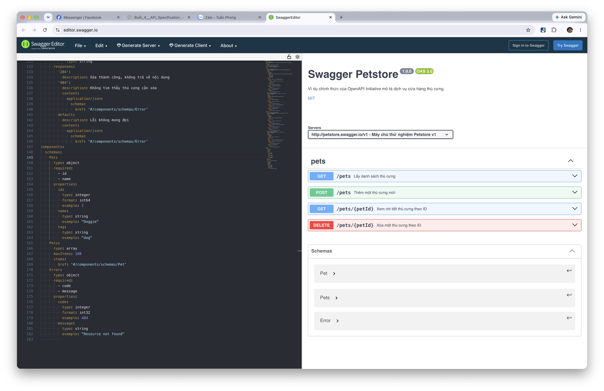

# Báo cáo thực hành Tuần 4: API Specification và OpenAPI

## 1. Lab Petstore (OpenAPI 3.0.3)

- **Mục tiêu thực hiện**: Xây dựng file đặc tả OpenAPI Specification 3.0.3 cho dịch vụ Petstore và kiểm thử hiển thị giao diện tài liệu với Swagger UI.
- **File kết quả**:
  - [`petstore.yaml`](./petstore.yaml): File đặc tả OpenAPI gồm các endpoints `/pets`, `/pets/{petId}` (hỗ trợ các phương thức `GET`, `POST`, `DELETE`), định nghĩa đầy đủ các Schemas (`Pet`, `Pets`, `Error`) và bổ sung các mã lỗi chuẩn (`400`, `404`).
  - [`screenshot_petstore.png`](./screenshot_petstore.png): Ảnh chụp màn hình Swagger UI render thành công file đặc tả.
  - [`phong_petstore.zip`](./phong_petstore.zip): File nén chứa `petstore.yaml` và `screenshot_petstore.png` để nộp bài.

### Minh chứng giao diện Swagger UI:


---

## 2. Đặc tả Tasks API 5 Endpoints (`openapi.yaml` & `openapi.json`)

Đã thiết kế hoàn chỉnh file đặc tả chuẩn OpenAPI 3.0.3 cho hệ thống quản lý công việc (Tasks API):

- **File đặc tả**: [`openapi.yaml`](./openapi.yaml) và bản xuất JSON [`openapi.json`](./openapi.json).
- **Chi tiết 5 endpoints đã mô tả**:
  1. `GET /tasks` (hoặc `/v1/tasks`): Lấy danh sách công việc, hỗ trợ tham số phân trang `limit` (mặc định 20, tối đa 100) và lọc theo `status` (`open`, `in_progress`, `done`).
  2. `POST /tasks`: Tạo mới công việc, kiểm tra bắt buộc trường `title`, sinh mã UUID tự động, trả về mã status `201 Created` kèm header `Location`.
  3. `GET /tasks/{taskId}`: Lấy chi tiết công việc dựa theo mã UUID, trả về `404 Not Found` nếu không tìm thấy.
  4. `PATCH /tasks/{taskId}`: Cập nhật một phần thông tin công việc (JSON Merge Patch) với các trường tùy chọn (`title`, `status`, `priority`, `dueDate`, `assigneeId`).
  5. `DELETE /tasks/{taskId}`: Xóa vĩnh viễn công việc, trả về mã status `204 No Content`.
- **Chuẩn hóa phản hồi lỗi**: Áp dụng chuẩn **RFC 7807 (Problem Details)** với header `Content-Type: application/problem+json` gồm các trường `type`, `title`, `status`, `detail`, `instance` và `traceId`.

---

## 3. Triển khai Flask App và nhúng Swagger UI (`app.py`)

Đã lập trình ứng dụng Flask tích hợp tài liệu tự động:

- **File mã nguồn**: [`app.py`](./app.py).
- **Các tính năng đã triển khai**:
  - Cài đặt đầy đủ logic xử lý cho 5 endpoints thao tác với dữ liệu mẫu in-memory (`TASKS_DB`).
  - Endpoint `GET /openapi.json`: Trả về dữ liệu đặc tả OpenAPI dưới dạng JSON.
  - Endpoint `GET /openapi.yaml`: Trả về dữ liệu đặc tả dạng YAML thô.
  - Endpoint `GET /docs`: Nhúng giao diện tương tác **Swagger UI** (sử dụng Swagger UI Bundle v5 qua CDN), cho phép tương tác trực tiếp bằng tính năng **"Try it out"**.
  - Xử lý xác thực dữ liệu đầu vào và bắt lỗi trả về cấu trúc Problem Details chuẩn.

### Cách khởi chạy ứng dụng:
```bash
# Di chuyển vào thư mục Week4 và chạy server Flask
python app.py
```
- Truy cập Swagger UI tại: `http://localhost:5000/docs`
- Đường dẫn OpenAPI JSON: `http://localhost:5000/openapi.json`
