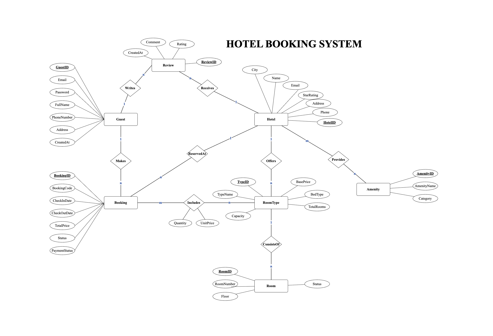

# Báo cáo thực hành Tuần 5: Data Modeling, Resource Design và Pagination Strategies

Họ và tên: Phạm Tuấn Phong
Mã sinh viên: 24021596

---

**(Hệ thống Đặt phòng Khách sạn - Hotel Booking)**

## 1. Bài 1 — Resource Design

### 1.1 Lựa chọn Domain & Phân tích Nghiệp vụ
Hệ thống Đặt phòng Khách sạn cung cấp dịch vụ tra cứu khách sạn, loại phòng, đặt phòng trực tuyến và quản lý đánh giá trải nghiệm:
- Hotel: Thông tin định danh, tên, địa chỉ, thành phố, xếp hạng sao (1–5), thông tin liên hệ và tiện ích kèm theo.
- Room type & Room: Mỗi khách sạn có nhiều loại phòng (Deluxe, Suite, Standard). Mỗi loại phòng quản lý danh sách các phòng vật lý.
- Booking: First-class resource có vòng đời độc lập (`pending` -> `confirmed` -> `checked_in` -> `completed` / `cancelled`), liên kết với khách hàng và khách sạn.
- Booking Detail: Bảng trung gian lưu trữ snapshot đơn giá tại thời điểm đặt, số lượng phòng và số đêm.
- Review: Khách hàng đánh giá 1 – 5 sao và bình luận sau khi sử dụng dịch vụ.
- Amenity & HotelAmenity Quản lý danh mục tiện ích dùng chung và bảng liên kết nhiều-nhiều.

---

### 1.2 Sơ đồ Thực thể Quan hệ



#### Phân tích bản số quan hệ (Cardinality) & Quyết định ánh xạ API:
| Cặp thực thể | Bản số | Loại quan hệ | Ánh xạ API (Decision Tree Slide 12) |
| :--- | :---: | :---: | :--- |
| HOTELS – ROOM_TYPES | 1 : N | Composition (Strong) | Nested Sub-resource: `/hotels/{id}/room-types` |
| ROOM_TYPES – ROOMS | 1 : N | Composition (Strong) | Nested Sub-resource: `/hotels/{id}/rooms` |
| USERS – BOOKINGS | 1 : N | Association (Weak) | Top-level với filter: `/bookings?user_id=...` |
| BOOKINGS – DETAILS | 1 : N | Composition (Strong) | Sub-resource: `/bookings/{id}/items` |
| ROOM_TYPES – DETAILS | 1 : N | Association | Junction lưu metadata (unit_price, quantity) |
| HOTELS – REVIEWS | 1 : N | Strong Containment | Nested Sub-resource: `/hotels/{id}/reviews` |
| HOTELS – AMENITIES | N : M | Many-to-Many | Junction Pair endpoint: `/hotels/{id}/amenities` |

---

### 1.3 Thiết kế Resource Set & Danh sách 18 URL Endpoints
Tuân thủ đầy đủ 7 quy tắc đặt tên URL và Cây quyết định Nested vs Top-level:
1. Danh từ số nhiều, kebab-case (`/hotels`, `/room-types`, `/bookings`).
2. HTTP Method đại diện cho hành động (GET, POST, PUT, PATCH, DELETE) — không nhúng động từ vào URL.
3. ID ổn định và nhất quán với tiền tố định danh (`hotel_...`, `bk_...`, `room_...`).
4. Không để lộ cấu trúc Database Schema (tránh `/tbl_hotels`, `/tbl_bookings`).
5. Không nhúng phần mở rộng file (`.json`) vào URI.
6. Độ sâu URL tối đa 2 cấp, không lồng ghép quá sâu.

| # | HTTP Method | URL Endpoint | Mục đích nghiệp vụ & Phân loại Pattern |
| :-: | :--- | :--- | :--- |
| 1 | `GET` | `/hotels` | Lấy danh sách khách sạn (Top-level). Hỗ trợ filter (`city`, `star_rating`, `price_min`, `price_max`) & phân trang. |
| 2 | `POST` | `/hotels` | Tạo mới khách sạn (Payload validate theo JSON Schema Hotel). |
| 3 | `GET` | `/hotels/{hotelId}` | Xem chi tiết khách sạn theo ID. |
| 4 | `PUT` | `/hotels/{hotelId}` | Cập nhật toàn bộ thông tin khách sạn. |
| 5 | `DELETE` | `/hotels/{hotelId}` | Xóa khách sạn (trả về 204 No Content). |
| 6 | `GET` | `/hotels/{hotelId}/room-types` | Danh sách loại phòng của khách sạn (Nested Pattern A: Strong containment). |
| 7 | `POST` | `/hotels/{hotelId}/room-types` | Tạo loại phòng mới cho khách sạn chỉ định. |
| 8 | `GET` | `/hotels/{hotelId}/rooms` | Danh sách các phòng cụ thể (hỗ trợ `?status=available`). |
| 9 | `GET` | `/hotels/{hotelId}/reviews` | Danh sách đánh giá của khách sạn (Nested sub-resource). |
| 10 | `POST` | `/hotels/{hotelId}/reviews` | Gửi đánh giá và chấm sao (1–5) cho khách sạn. |
| 11 | `GET` | `/hotels/{hotelId}/amenities` | Danh sách tiện ích trang bị tại khách sạn (Junction N:M). |
| 12 | `POST` | `/hotels/{hotelId}/amenities` | Gán tiện ích cho khách sạn (Junction association). |
| 13 | `GET` | `/bookings` | Danh sách đơn đặt phòng (Top-level Pattern B: tra cứu đa chiều qua query params). |
| 14 | `POST` | `/bookings` | Tạo đơn đặt phòng mới (First-class resource độc lập). |
| 15 | `GET` | `/bookings/{bookingId}` | Xem chi tiết đơn đặt phòng, phòng đã đặt và trạng thái thanh toán. |
| 16 | `PATCH` | `/bookings/{bookingId}` | Hủy đơn hoặc cập nhật trạng thái đơn đặt phòng (không dùng `/cancelBooking`). |
| 17 | `GET` | `/users/{userId}/bookings` | Lịch sử đặt phòng của một khách hàng cụ thể (Sub-resource view). |
| 18 | `GET` | `/amenities` | Danh mục toàn bộ các tiện ích dùng chung trong toàn hệ thống. |

---

### 1.4 Đặc tả 3 JSON Schemas
Được lưu tại thư mục [`schemas/`](./schemas/):
1. [`schemas/hotel.json`](./schemas/hotel.json): Schema đặc tả Khách sạn (Wire format: giá tiền có cấu trúc, chuẩn ISO 8601 cho thời gian, embed tóm tắt tiện ích).
2. [`schemas/booking.json`](./schemas/booking.json): Schema đặc tả Đơn đặt phòng (embed thông tin khách hàng, mảng `items` phòng đặt qua `$defs`, chi tiết trạng thái thanh toán).
3. [`schemas/room.json`](./schemas/room.json): Schema đặc tả Phòng khách sạn (embed thông tin loại phòng, tình trạng sẵn sàng phục vụ).

*Tất cả 3 schema đều đã được kiểm thử hợp lệ 100% bằng thư viện `jsonschema` của Python.*

---

## 2. Bài 2 — Thực hành Triển khai Chiến thuật Phân trang Flask Pagination

### 2.1 Các tính năng chính đã cài đặt
Trong [`app.py`](./app.py) và [`models.py`](./models.py):
1. Hỗ trợ linh hoạt 2 chiến lược phân trang qua `?strategy=...`:
   - `strategy=offset`:
     - Tham số: `offset` (mặc định 0), `limit` (mặc định 20, tối đa 100).
     - Đếm tổng số bản ghi bằng `func.count()`.
     - Trả về metadata: `offset, limit, total, current_page, total_pages, has_next, has_prev`.
   - `strategy=cursor`:
     - Tham số: `cursor` (Base64 URL-safe token), `limit`.
     - Kỹ thuật `limit + 1`: Fetch thêm 1 bản ghi để xác định `has_more` mà không tốn chi phí `COUNT(*)`.
     - Deterministic Tie-Breaking: Kết hợp `Book.id` vào điều kiện seek tuple/boolean nhằm ngăn chặn lỗi lặp hoặc sót bản ghi khi có nhiều cuốn sách cùng giá trị sắp xếp.
     - Trả về metadata: `limit, next_cursor, has_more`.
2. Lọc dữ liệu (Filtering):
   - Lọc theo thể loại: `?genre=tech`, `?genre=fiction`, `?genre=science`, `?genre=business`, `?genre=history`.
   - Lọc theo khoảng giá và tồn kho: `?price_min=...&price_max=...&in_stock=true`.
3. Sắp xếp đa khóa (Multi-key sort):
   - Hỗ trợ cú pháp chuỗi: `?sort=-price,title` (sắp xếp giá giảm dần, nếu trùng thì xếp theo tựa đề A-Z).
   - Sort Column Whitelisting chống SQL Injection (Slide 23, 28): Danh sách cột an toàn gồm `['id', 'price', 'title', 'stock', 'created_at']`. Từ chối cột lạ với HTTP 400 Bad Request.
4. Xác thực Cursor Token:
   - Phát hiện token hỏng/sai cú pháp -> HTTP 400.
   - Phát hiện `sort_mismatch` (token được sinh cho sort khác với request hiện tại) -> HTTP 400 yêu cầu duyệt lại từ đầu.
5. Cắt gọt trường hiển thị (Sparse Fieldsets):
   - `?fields=id,title,price` giúp tối ưu băng thông đường truyền.
6. Khởi tạo dữ liệu mẫu (Seed Data):
   - Tự động nạp sẵn 60 cuốn sách mẫu, 5 thể loại và 9 tác giả nổi tiếng ngay khi khởi động.

---

### 2.2 Hướng dẫn cài đặt và chạy ứng dụng

```bash
# 1. Di chuyển vào thư mục Week5
cd Week5

# 2. Kích hoạt môi trường ảo Python
source .venv/bin/activate

# 3. Khởi chạy server Flask (cổng 5000)
python3 app.py
```

Server sẽ tự động khởi tạo database SQLite `bookstore.db` và nạp dữ liệu mẫu.

---

### 2.3 Chạy bộ kiểm thử tự động

Toàn bộ 14 kịch bản kiểm thử được viết tại [`test_pagination.py`](./test_pagination.py):

```bash
pytest test_pagination.py -v
```

Kết quả kiểm thử thực tế:
```text
============================= test session starts ==============================
collected 14 items

test_pagination.py::test_offset_pagination_first_page PASSED             [  7%]
test_pagination.py::test_offset_pagination_second_page PASSED            [ 14%]
test_pagination.py::test_offset_pagination_out_of_range PASSED           [ 21%]
test_pagination.py::test_cursor_pagination_traversal PASSED              [ 28%]
test_pagination.py::test_cursor_pagination_until_exhaustion PASSED       [ 35%]
test_pagination.py::test_cursor_with_sort_composite_tie_breaker PASSED   [ 42%]
test_pagination.py::test_filter_by_genre PASSED                          [ 50%]
test_pagination.py::test_filter_price_range PASSED                       [ 57%]
test_pagination.py::test_multi_key_sorting PASSED                        [ 64%]
test_pagination.py::test_whitelist_sort_column_reject_invalid PASSED     [ 71%]
test_pagination.py::test_invalid_cursor_token PASSED                     [ 78%]
test_pagination.py::test_cursor_sort_mismatch_rejection PASSED           [ 85%]
test_pagination.py::test_invalid_pagination_strategy PASSED              [ 92%]
test_pagination.py::test_sparse_fieldsets PASSED                         [100%]

============================== 14 passed in 1.16s ==============================
```

---

### 2.4 File Postman Collection
- File: [`Bookstore_Pagination.postman_collection.json`](./Bookstore_Pagination.postman_collection.json).
- Import vào ứng dụng Postman để kiểm thử trực quan với đầy đủ test scripts tự động lưu `nextCursor` giữa các trang.

---