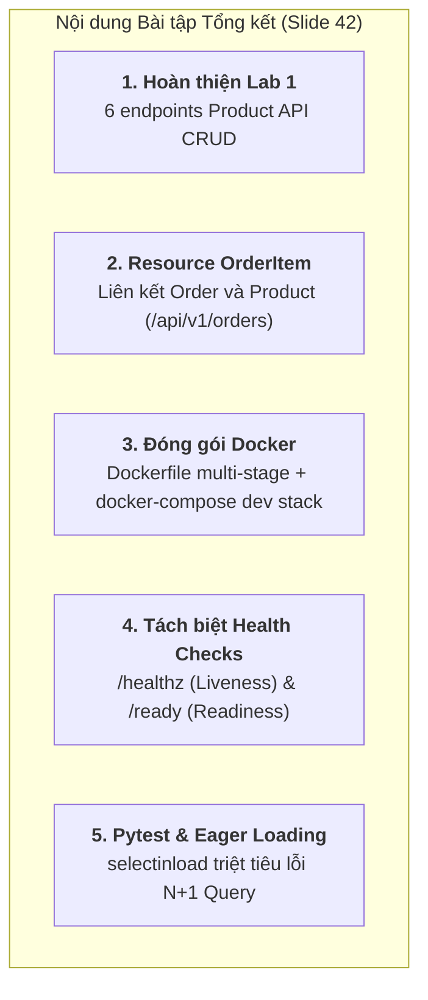

# Bài tập Buổi 07: Nguyên lý triển khai Backend Service

Dự án này hoàn thiện toàn bộ **5 yêu cầu bài tập tổng kết** (Slide 42 của bài giảng SOA - Buổi 07), đồng thời đóng gói phần so sánh **Code-First & Design-First** vào một thư mục riêng biệt mang tên [`code&design first/`](file:///Users/tuanphong/Downloads/KTHDV/HK1_2627__INT3505E_2/Week7/code&design%20first).

---

## 1. Danh sách 5 yêu cầu bài tập đã hoàn thành (Slide 42)



### ✅ Yêu cầu 1: Hoàn thiện Lab 1 — Product API CRUD (6 endpoints)
Triển khai tại [`src/api/products.py`](file:///Users/tuanphong/Downloads/KTHDV/HK1_2627__INT3505E_2/Week7/src/api/products.py):
1. `GET /api/v1/products`: Lấy danh sách có phân trang `?page=1&size=20`, tự động loại trừ `archived=True`.
2. `GET /api/v1/products/<int:id>`: Lấy chi tiết 1 sản phẩm (trả `404` nếu không tìm thấy hoặc đã xóa mềm).
3. `POST /api/v1/products`: Tạo mới sản phẩm (báo lỗi `409 Conflict` nếu trùng `sku`).
4. `POST /api/v1/products/<int:id>/reserve`: Đặt trước tồn kho `{"qty": 1}`, trừ `qty_in_stock` an toàn, báo `409 OutOfStock` nếu vượt quá số lượng còn lại.
5. `PATCH /api/v1/products/<int:id>`: Cập nhật từng phần (chỉ sửa các trường gửi lên trong JSON body).
6. `DELETE /api/v1/products/<int:id>`: Xóa mềm sản phẩm (`archived=True`), trả `204 No Content`.

### ✅ Yêu cầu 2: Resource OrderItem liên kết Order và Product
Triển khai tại [`src/api/orders.py`](file:///Users/tuanphong/Downloads/KTHDV/HK1_2627__INT3505E_2/Week7/src/api/orders.py):
- Xây dựng model `Order` và `OrderItem` độc lập với quan hệ 1-N (tránh gán 1 Product duy nhất cho Order).
- Blueprint riêng biệt tại prefix `/api/v1/orders`.
- Hỗ trợ tạo đơn hàng chứa nhiều mặt hàng và hiển thị chi tiết đơn hàng kèm danh sách sản phẩm.

### ✅ Yêu cầu 3: Đóng gói Dockerfile + docker-compose
Triển khai tại [`Dockerfile`](file:///Users/tuanphong/Downloads/KTHDV/HK1_2627__INT3505E_2/Week7/Dockerfile) và [`docker-compose.yml`](file:///Users/tuanphong/Downloads/KTHDV/HK1_2627__INT3505E_2/Week7/docker-compose.yml):
- **Dockerfile multi-stage** (Slide 40): Tách stage 1 (Builder với công cụ `uv` siêu tốc) và stage 2 (Runtime nhẹ chạy dưới user không có đặc quyền root `app:app`).
- **docker-compose.yml** (Slide 41): Chạy container PostgreSQL 16 Alpine, cấu hình `healthcheck` với lệnh `pg_isready`, container API chỉ khởi chạy khi DB đã thực sự sẵn sàng (`condition: service_healthy`).

### ✅ Yêu cầu 4: Thêm `/healthz` + `/ready` không gộp chung
Triển khai tại [`src/api/health.py`](file:///Users/tuanphong/Downloads/KTHDV/HK1_2627__INT3505E_2/Week7/src/api/health.py):
- `GET /healthz` (**Liveness probe**): Kiểm tra nhanh tiến trình web còn sống hay không, không chạm DB, trả `200 OK`.
- `GET /ready` (**Readiness probe**): Kiểm tra hệ thống đã sẵn sàng nhận traffic hay chưa, thực hiện `SELECT 1` ping tới Database (trả `200` nếu sẵn sàng, `503` nếu DB lỗi).

### ✅ Yêu cầu 5: Pytest với Eager Loading kiểm tra số truy vấn ngăn chặn N+1
Triển khai tại [`tests/test_orders_eager_loading.py`](file:///Users/tuanphong/Downloads/KTHDV/HK1_2627__INT3505E_2/Week7/tests/test_orders_eager_loading.py):
- Áp dụng `selectinload(Order.items).selectinload(OrderItem.product)`.
- Gắn SQLAlchemy Event Listener `before_cursor_execute` đếm số lượng câu lệnh SQL `SELECT` phát ra: xác nhận số lượng query luôn là hằng số $\le 3$ (nhờ mệnh đề `WHERE order_id IN (...)`), triệt tiêu hoàn toàn bẫy $1 + N$ queries (Slide 20, 21).

---

## 2. Cấu trúc thư mục dự án

```text
Week7/
├── code&design first/              # 👈 THƯ MỤC RIÊNG CHỨA DEMO SO SÁNH
│   ├── code_first/                 # Demo Code-First dùng flask-smorest + Marshmallow
│   ├── design_first/               # Demo Design-First dùng Connexion + openapi.yaml
│   └── README.md                   # Hướng dẫn và ma trận so sánh chi tiết
│
├── src/                            # 👈 MÃ NGUỒN CHÍNH CỦA BÀI TẬP (Slide 14)
│   ├── factory.py                  # Application Factory create_app() (Slide 13, 16)
│   ├── config.py                   # Cấu hình 12-factor (DefaultConfig, TestConfig, ProductionConfig)
│   ├── extensions.py               # db = SQLAlchemy(), migrate = Migrate() (Slide 15)
│   ├── errors.py                   # Custom exceptions (ApiError, NotFound, Conflict...) & RFC handlers
│   ├── logging_config.py           # Structured JSON Logging theo dõi latency ms (Slide 35)
│   ├── api/
│   │   ├── products.py             # 6 endpoints Lab 1 Product CRUD (Slide 24, 27, 28)
│   │   ├── orders.py               # Resource Order & OrderItem (Bài tập 2, Slide 42)
│   │   ├── health.py               # /healthz & /ready tách biệt (Bài tập 4, Slide 37)
│   │   └── schemas.py              # Marshmallow schemas validate input & serialize output
│   └── models/
│       ├── product.py              # Model Product typed SQLAlchemy 2.x (Slide 18, 25)
│       └── order.py                # Model Order & OrderItem (Slide 42)
│
├── tests/                          # 👈 BỘ KIỂM THỬ PYTEST (100% Passed)
│   ├── conftest.py                 # Fixtures test client & in-memory SQLite
│   ├── test_lab1_products.py       # Kiểm thử toàn diện 6 endpoints CRUD Lab 1
│   ├── test_orders_eager_loading.py# Kiểm thử tạo Order và đo số câu SQL triệt tiêu N+1
│   └── test_health.py              # Kiểm thử liveness /healthz và readiness /ready
│
├── Dockerfile                      # Multi-stage Dockerfile (Slide 40)
├── docker-compose.yml              # Dev stack postgres + api + healthcheck (Slide 41)
├── wsgi.py                         # WSGI entry point (Slide 14, 39)
├── requirements.txt                # Danh sách thư viện phụ thuộc
├── .env.example                    # Mẫu cấu hình môi trường
├── pytest.ini                      # Cấu hình Pytest
└── README.md                       # Tài liệu hướng dẫn
```

---

## 3. Hướng dẫn chạy thử nghiệm Localhost

### Bước 1: Kích hoạt môi trường ảo
```bash
cd /Users/tuanphong/Downloads/KTHDV/HK1_2627__INT3505E_2/Week7
source .venv/bin/activate
```

### Bước 2: Khởi động Backend Service
```bash
python wsgi.py
```
*(Service sẽ lắng nghe tại cổng `http://localhost:5000`)*

---

### Bước 3: Thử nghiệm bằng lệnh cURL

#### 1. Kiểm tra sức khỏe (Health checks):
```bash
# Liveness probe
curl http://localhost:5000/healthz
# Kết quả: {"status": "ok"}

# Readiness probe (ping DB)
curl http://localhost:5000/ready
# Kết quả: {"checks": {"db": "ok"}, "status": "ok"}
```

#### 2. Quản lý Sản phẩm (Lab 1 CRUD):
```bash
# Tạo sản phẩm mới (POST)
curl -X POST http://localhost:5000/api/v1/products \
  -H "Content-Type: application/json" \
  -d '{"sku": "SKU-IPHONE-15", "name": "iPhone 15 Pro Max", "price_cents": 120000, "qty_in_stock": 10}'

# Lấy danh sách sản phẩm có phân trang (GET)
curl "http://localhost:5000/api/v1/products?page=1&size=20"

# Đặt trước 2 sản phẩm (Reserve)
curl -X POST http://localhost:5000/api/v1/products/1/reserve \
  -H "Content-Type: application/json" \
  -d '{"qty": 2}'

# Cập nhật thông tin (PATCH)
curl -X PATCH http://localhost:5000/api/v1/products/1 \
  -H "Content-Type: application/json" \
  -d '{"name": "iPhone 15 Pro Max (Titanium)"}'

# Xóa mềm sản phẩm (DELETE)
curl -X DELETE http://localhost:5000/api/v1/products/1
```

#### 3. Quản lý Đơn hàng & OrderItem (Bài tập 2):
```bash
# Tạo thêm sản phẩm thứ 2
curl -X POST http://localhost:5000/api/v1/products \
  -H "Content-Type: application/json" \
  -d '{"sku": "SKU-MACBOOK-01", "name": "MacBook Pro M3", "price_cents": 350000, "qty_in_stock": 5}'

# Tạo đơn hàng liên kết nhiều OrderItem với các sản phẩm
curl -X POST http://localhost:5000/api/v1/orders \
  -H "Content-Type: application/json" \
  -d '{
    "order_number": "ORD-2024-001",
    "customer_email": "student@example.com",
    "items": [
      {"product_id": 1, "quantity": 1},
      {"product_id": 2, "quantity": 1}
    ]
  }'

# Lấy danh sách toàn bộ đơn hàng (Eager loading)
curl http://localhost:5000/api/v1/orders
```

---

## 4. Chạy bộ kiểm thử tự động (Pytest)

```bash
pytest -v
```

**Kết quả kiểm thử:**
```text
tests/test_health.py::test_liveness_probe_healthz PASSED                 [ 16%]
tests/test_health.py::test_readiness_probe_ready PASSED                  [ 33%]
tests/test_lab1_products.py::test_lab1_full_product_crud_lifecycle PASSED [ 50%]
tests/test_lab1_products.py::test_lab1_validation_errors PASSED          [ 66%]
tests/test_orders_eager_loading.py::test_post_order_with_multiple_items PASSED [ 83%]
tests/test_orders_eager_loading.py::test_eager_loading_prevents_n_plus_one_queries PASSED [100%]

============================== 6 passed in 0.08s ===============================
```

---

## 5. Triển khai Docker và Docker Compose (Bài tập 3)

Khởi động toàn bộ stack gồm cơ sở dữ liệu PostgreSQL 16 và backend service:
```bash
docker compose up --build
```
Hệ thống sẽ tự động build image multi-stage và khởi chạy service an toàn dưới người dùng không đặc quyền root.
